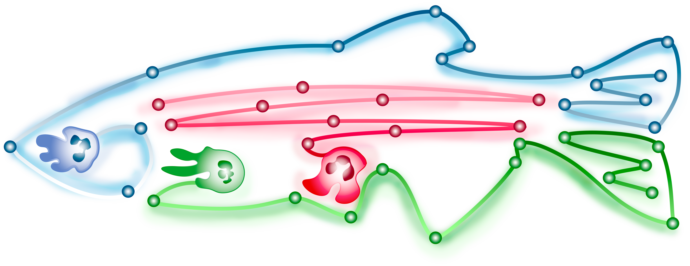

<p align="center">
  
</p>

<p align="center">
  
</p>

## Description

FITS—Fluorescent Image Tracking Software—is a reproducible workflow for
processing and quantifying fluorescence-microscopy experiments. It brings image
conversion, registration, background subtraction, segmentation, tracking,
spatial profiling, and labeled-region extraction into one experiment-aware
pipeline.

The project is aimed at researchers who should not need to write Python to run
an analysis. Its desktop interface exposes pipeline settings and dedicated
viewers for segmentation tuning, reference masks, and ROI masks, while the CLI
supports scripted and repeatable runs. Both use the same settings models and
workflow engine.

[User guide](docs/user_guide/README.md) · [Developer documentation](docs/dev/README.md)

## Install

### Requirements

- **Linux or Windows.** A macOS installer is available for testing.
- **Git**, installed and available in your terminal (`git --version`).
- **uv**, the tool that installs Python and the libraries FITS needs in a dedicated
  environment. Setup installs uv automatically if missing; existing installations
  are reused.
- **Internet access** and a folder you can write to for the Git clone.

You do not need to install Python separately. Setup installs Python 3.12 and
creates the repository's `.venv`. **A GPU is optional.** Run the installer as
normal user, without `sudo` or **Run as administrator**, and keep the repository
folder afterward: the shortcuts launch FITS from there.

### Linux

Install [Git](https://git-scm.com/downloads/linux), then run:

```bash
git clone https://github.com/BennyGinger/FITS.git fits
cd fits
bash install_linux.sh
```

Open **FITS** from your Applications menu, or run
`bash startup/launch_linux.sh` from the repository folder.

### Windows

Install [Git for Windows](https://git-scm.com/downloads/win), open PowerShell,
then run:

```powershell
git clone https://github.com/BennyGinger/FITS.git fits
cd fits
.\install_win.bat
```

Open **FITS** from the Start menu or desktop shortcut.

### macOS (experimental)

Follow the [macOS installation instructions](docs/user_guide/installation.md#macos-experimental).
Mac dependency compatibility and processing still require validation on real hardware.

For an existing clone, pull FITS updates and rerun its installer from the main
repository folder. Setup updates clean, older submodules to the versions required
by that checkout before installing dependencies. Interactive installers wait for
**Enter** before finishing; `--pause` is unnecessary.

### Optional Tad installation

Setup offers to install [Tad](https://www.tadviewer.com/), a separate application
for viewing FITS measurement tables (`.parquet`). It is optional and maintained
independently of FITS. Once installed, double-click a Parquet file in the FITS
run browser to open it.

See [optional Tad setup](docs/user_guide/installation.md#optional-tad-installation)
for supported platforms, installation options, and the Data Wrangler alternative.
For installer failures, updates, or repair, see the
[installation guide](docs/user_guide/installation.md#installation-details).

## Quick usage

1. Open FITS, choose your run folder containing the raw acquisitions, and enter
   your user name.
2. In **Convert**, enter channel labels in source order, select channels to
   export, then click **Next**.
3. Enable the preprocessing, segmentation, tracking, and analysis steps you need.
   Use **Preview** to inspect and tune the relevant settings.
4. Click **Run pipeline**. If an enabled analysis requests REF/ROI masks,
   complete the drawing workflow when prompted.
5. Inspect images and masks in **Image / Mask Viewer**, read the completion
   report, and open the saved Parquet measurements from the run browser.

See [Understanding the output tables](docs/user_guide/output_tables.md) for each
column's meaning, units, and examples of grouping measurements.

For detailed instructions, start with the [user-guide index](docs/user_guide/README.md).
The chapters cover settings, previews, processing, and results. A worked example
dataset and screenshots are still being prepared. See also
[reprocessing and file management](docs/user_guide/reprocessing_and_file_management.md)
for overwrites, conflicts, compaction, and backups.

Projects can be moved as complete folders. See
[what is portable and how to refresh paths/tags](docs/user_guide/portable_projects.md).

Command-line users can launch the GUI with `uv run fits-gui` or process a settings
file with `uv run fits run /path/to/settings.toml`, from the FITS repository.

## Citations and acknowledgments

FITS builds on the work of the following projects and their contributors.
When publishing results, cite the methods and models actually used in your
analysis and record your FITS version and settings. Follow each project's
citation guidance for its particular version/model.

| Project | Contribution to FITS |
| --- | --- |
| [Cellpose](https://github.com/MouseLand/cellpose#citation) | Cell segmentation and model-specific restoration. |
| [nd2](https://github.com/tlambert03/nd2) | Nikon ND2 images and metadata. |
| [tifffile](https://github.com/cgohlke/tifffile), [imagecodecs](https://github.com/cgohlke/imagecodecs), [roifile](https://github.com/cgohlke/roifile) | TIFF reading/writing, compression, and ImageJ ROI/overlay support. |
| [SMO](https://github.com/maurosilber/SMO#citation) | Silver Mountain Operator background estimation and subtraction. |
| [pyStackReg](https://github.com/glichtner/pystackreg) / [TurboReg and StackReg](https://bigwww.epfl.ch/thevenaz/turboreg/) | Image registration. |
| [OpenCV](https://opencv.org/), [scikit-image](https://scikit-image.org/) | Registration and image-processing algorithms. |
| [Trackastra](https://arxiv.org/abs/2405.15700) | Cell tracking. |
| [µSAM](https://doi.org/10.1038/s41592-024-02580-4), [Segment Anything](https://arxiv.org/abs/2304.02643), [MobileSAM](https://arxiv.org/abs/2306.14289) | Prompt-based mask prediction in the tracking editor. |

FITS also relies on **NumPy, SciPy, pandas, PyArrow, PyTorch, joblib, PySide6/Qt,
pyqtgraph, Pydantic, Typer, Rich, tqdm**, and the wider Python ecosystem.
**uv** supports installation and environment management; **Tad** is an optional
independent table viewer.

FITS's companion libraries—**scope_io, cellpose_kit, stackalign, bg_sub, tracklink,
mask_interpolation, bioimagequant, and progress_bar**—connect these tools to the
workflow. See [software credits and citation guidance](docs/dev/software_credits.md)
for project links, method references, and supporting-library acknowledgments.
